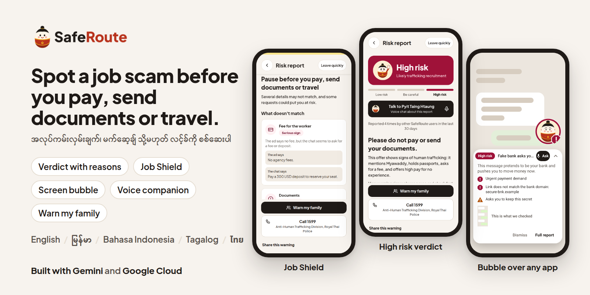
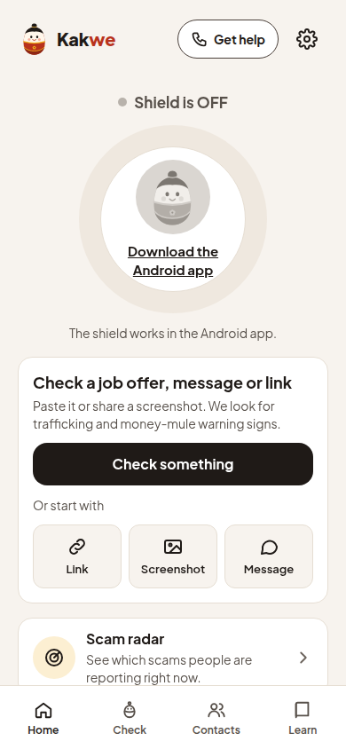
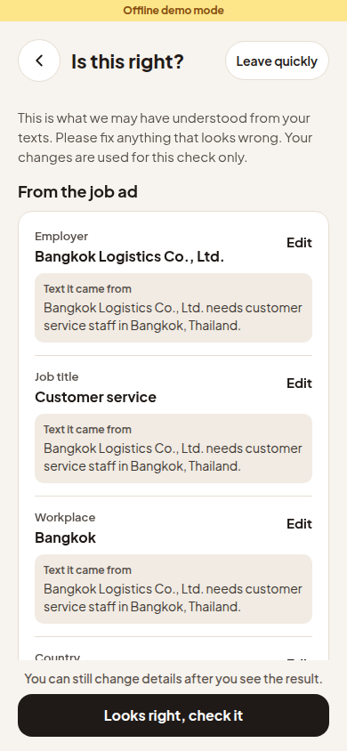
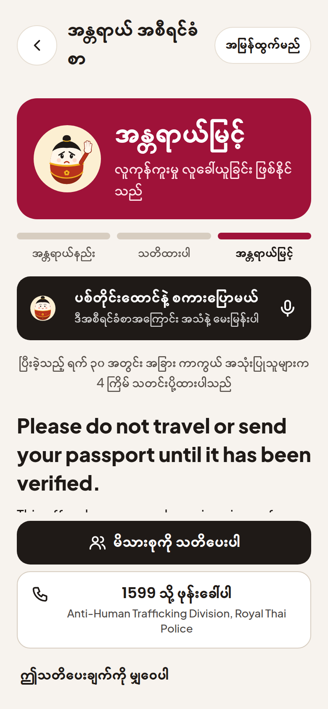
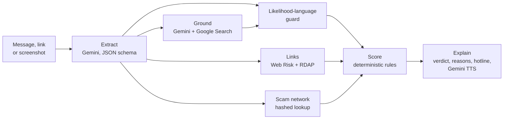

<picture>
  <source media="(prefers-color-scheme: dark)" srcset="assets/readme/cover-dark.png">
  
</picture>

# Kakwe

Kakwe is called ကာကွယ် when the app language is Burmese. It was named SafeRoute before.

Migrant workers from Myanmar, Thailand, Indonesia and the Philippines find jobs through social media ads and chat apps. Some of those offers lead to debt, forced scam work or trafficking, and the warning signs are easy to miss in a second language. Kakwe is an Android app and a web demo that checks a job ad, message, link or screenshot before the person pays, sends documents or travels. It explains what it found in the user's own language and points to a verified hotline. Built for the Google Cloud AI Builder Cup 2026.

**[Web demo](https://saferoute-aibc.web.app)** · **[Android APK](https://saferoute-aibc.web.app/kakwe.apk)** · **[Dataset](https://huggingface.co/datasets/Rickaym/saferoute-scam-screenshots)** · **[Pitch deck](pitch/deck.pdf)**

## Features

| Feature | What it does |
| --- | --- |
| **Check anything** | Paste a message or link, or share a screenshot. Get **Low risk**, **Be careful** or **High risk**, the quoted words behind it, and a verified hotline for your home and destination countries. |
| **Job Shield** | Compares the job ad with what the recruiter asks in chat and shows each gap, such as "no fees" in the ad and a deposit in the chat. |
| **Screen bubble** (Android) | A floating Pyit Taing Htaung doll checks whatever is on screen, in any app, with one tap. |
| **Voice companion** | Talk to Pyit Taing Htaung about a report in your language, on Gemini Live. |
| **Warn my family** | Sends the warning to a trusted contact by SMS or the share sheet. |
| **Scam network** (opt-in) | A risky check adds one anonymous, redacted signal. Repeat numbers and handles are matched as keyed hashes and raise the next person's warning. |
| **Languages** | English, Burmese, Bahasa Indonesia, Tagalog and Thai, for the app, the reports and the spoken warnings. |

<p align="center">
  
  
  
</p>

## How it works



1. One multimodal Gemini call reads the text or image and returns red flags, entities and links as schema-checked JSON.
2. Gemini with Google Search grounding checks whether named agencies and companies exist. Only organisation names, website hosts and the country go to search.
3. Web Risk and RDAP check every link and its domain age. The scam network checks hashed phone numbers and handles.
4. A language guard rewrites certainty wording ("is a scam" becomes "looks like a scam") in all five languages, and asks the model again when the output has three or more such phrases.
5. A deterministic rules engine sets the score and verdict. The model finds evidence; it cannot raise a verdict on its own.
6. The report and a spoken warning come back in the user's language.

Details: [docs/architecture.md](docs/architecture.md), [docs/api-contract.md](docs/api-contract.md), [docs/intel-design.md](docs/intel-design.md).

## Safety and privacy

- **Likelihood, never accusation.** Reports say "shows signs of" and never call a named person or company a criminal.
- **Leave quickly.** One button on every report clears the screen back to Home and stops any audio.
- **Nothing stored from the check.** Images and message text are not stored or logged. Synced history keeps only the verdict, a score band, the title and the summary, and history can be turned off.
- **Consent first.** Signal sharing is off until the user turns it on during setup or in Settings.
- **Hashed network.** Phones, handles and accounts are stored as HMAC-SHA256 hashes, signals expire after 90 days, and clients cannot read the network directly.

## Benchmarks

The [Protection Score](bench/README.md) asks one question per screenshot: did Kakwe give a frightened, low-literacy reader the right information to stay safe? It scores eight areas from 0 to 100, and critical failures (calling a dangerous message safe, inventing a phone number, accusing a named person) cap the case score.

All runs use `gemini-3.5-flash-lite` and the production prompt. A public evaluation set of 28 synthetic and 51 real redacted screenshots is on [Hugging Face](https://huggingface.co/datasets/Rickaym/saferoute-scam-screenshots).

| Set | Cases | Result |
| --- | --- | --- |
| Synthetic screenshots, 5 languages ([results](bench/RESULTS-v2.md)) | 24 | Protection Score **89.7**. 0 critical failures, 0 dangerous messages called safe, 0 false alarms, 48/48 quotes found in the image, verdict stable in 98% of 210 variants (blur, crop, dark mode, prompt injection) |
| Synthetic text eval (`server/eval`) | 31 | **31/31** correct, 0 responses with certainty wording after the guard, p50 2.8 s, p95 4.4 s |
| Real redacted screenshots | 54 | Protection Score **66.6**, provisional, on draft labels |

## Built with

| Google service | Use |
| --- | --- |
| Gemini API (`@google/genai`) | Extraction with a JSON response schema (`gemini-3.5-flash-lite`), Job Shield fact extraction |
| Grounding with Google Search | Checks that agencies and companies exist and looks for scam reports |
| Gemini text-to-speech | Spoken warnings, so Burmese and Thai work on phones with no matching voice (`gemini-3.8-flash-tts`) |
| Gemini Live API | The voice companion (`gemini-3.8-live`) |
| Web Risk API | Known malicious links |
| Firebase Auth, Firestore | Anonymous and Google sign-in, synced history and contacts, the scam network |
| Firebase Hosting, App Distribution | The web demo and tester builds |

The API is a Hono service in TypeScript. It also runs on Vertex AI with `GOOGLE_GENAI_USE_VERTEXAI=true`, and `scripts/deploy-cloudrun.sh` deploys it to Cloud Run.

## Run it locally

```bash
pnpm install --frozen-lockfile
EXPO_PUBLIC_OFFLINE_MOCK=1 pnpm web    # web app with the offline mock API
pnpm web                               # web app against the live API
pnpm check                             # typecheck, lint, tests

cd server && npm ci
MOCK=1 npm run dev                     # API on :8080 with canned answers
GEMINI_API_KEY=... npm run dev         # API with the real model
GEMINI_API_KEY=... npm run eval        # text eval
```

Deploy notes: [docs/setup-gcp.md](docs/setup-gcp.md). Repo layout and contributor rules: [CLAUDE.md](CLAUDE.md).

## Team and licence

Team Super Power Rangers: Pyae Sone Myo (Ricky), Min Thein Kyaw and May Myat Noe Aung.

[MIT](LICENSE). The doll is the Pyit Taing Htaung, the Myanmar roly-poly doll that always gets back up ([brand notes](docs/brand.md)).
