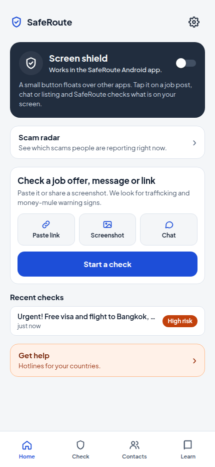
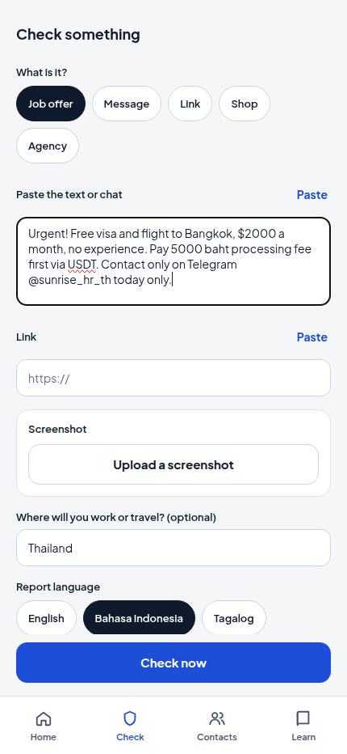
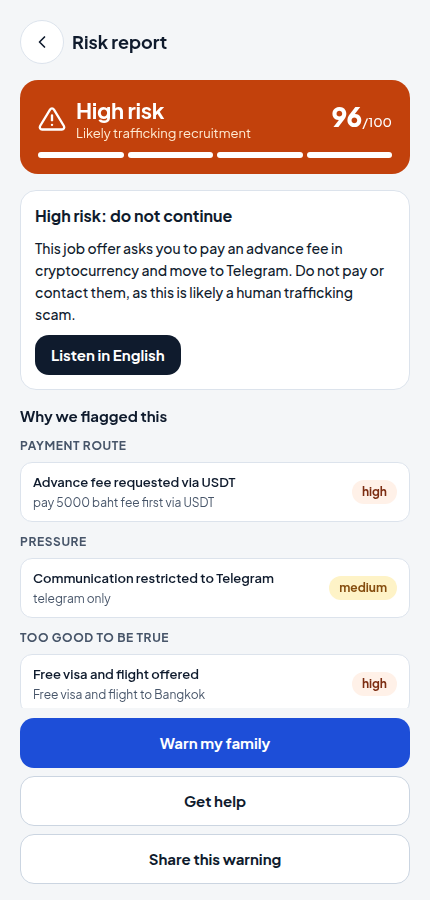
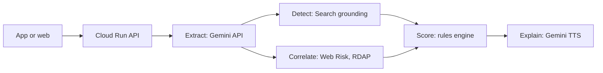

# SafeRoute

An Android app and web demo that checks a job offer, message, link or screenshot for scams and human trafficking, and explains the result in the user's language. Built for the Google Cloud AI Builder Cup 2026.

<p align="center">
  
  
  
</p>

Team: TBD

## Try it

- Web demo: https://saferoute-aibc.web.app
- Android APK: https://saferoute-aibc.web.app/saferoute.apk (allow installs from your browser)
- Testers: accept the Firebase App Distribution invite email, install Firebase App Tester, then download SafeRoute from it. New builds arrive as notifications.

## Demo video

[media/demo.mp4](media/demo.mp4), under 3 minutes. See [media/README.md](media/README.md).

## Pitch deck

[media/SafeRoute-deck.pdf](media/SafeRoute-deck.pdf)

## How it works



1. The app sends text, a link or a screenshot to one Cloud Run service.
2. One Gemini call reads the input, including image text, and returns red flags as JSON.
3. Gemini with Google Search grounding checks that named agencies and companies exist.
4. Google Web Risk and RDAP check each link and the domain age.
5. A deterministic rules engine sets the score and verdict: safe, careful or danger.
6. The report and a spoken warning come back in English, Bahasa Indonesia, Tagalog or Burmese.

Details: [docs/architecture.md](docs/architecture.md) and [docs/api-contract.md](docs/api-contract.md).

## Benchmarks

Both benchmarks run the real pipeline with `gemini-3.5-flash-lite`. Full results and history: [bench/RESULTS.md](bench/RESULTS.md).

**Text eval (27 cases)**, 2026-10-14. Four languages: en, id, tl, my. Source: `bench/results/2026-10-14-gemini-3.5-flash-lite-text-eval.json`.

| Accuracy | p50 | p95 |
| --- | --- | --- |
| 27/27 | 3.1 s | 4.8 s |

**Screenshot bench (N screenshots)**

| Status | Accuracy | False positives | p50 | p95 | PII leaks |
| --- | --- | --- | --- | --- | --- |
| pending: screenshots being collected | - | - | - | - | - |

The harness is checked on 6 synthetic screenshots (6/6 risky or safe matched). How to run it and the label format: [bench/README.md](bench/README.md).

## Privacy

- Screenshots and text are used for the check only. They are not stored and not logged.
- A risky check adds one anonymous, redacted signal to a shared scam radar. Phones and handles are stored as keyed hashes. Users can opt out in Settings. See [docs/intel-design.md](docs/intel-design.md).
- History and trusted contacts stay on the device unless the user signs in. Account deletion is in Settings and at `/delete-account`.

## Repo layout

| Path | Contents |
| --- | --- |
| `src/` | Expo (React Native) app: screens, API client, state |
| `modules/shield-module/` | Android overlay that checks the current screen |
| `server/` | Hono and TypeScript API on Gemini, Web Risk and RDAP |
| `server/eval/` | Text eval with 27 labelled cases |
| `bench/` | Screenshot benchmark, results and synthetic images |
| `docs/` | Architecture, API contract, GCP setup |
| `pitch/` | Deck source, demo inputs and video script |
| `media/` | Deck PDF and demo video |
| `scripts/` | Cloud Run deploy and APK signing |

## Run locally

```bash
pnpm install --frozen-lockfile
pnpm web                                  # web app, offline mock API
pnpm check                                # typecheck, lint, tests
cd server && npm ci && MOCK=1 npm run dev # API on :8080 with canned answers
GEMINI_API_KEY=... npm run dev            # same API with the real model
```

Point the app at an API with `EXPO_PUBLIC_API_URL=http://localhost:8080 pnpm web`. Code layout notes for contributors are in `CLAUDE.md`.

## Deploy

See [docs/setup-gcp.md](docs/setup-gcp.md).

## License

[MIT](LICENSE)
