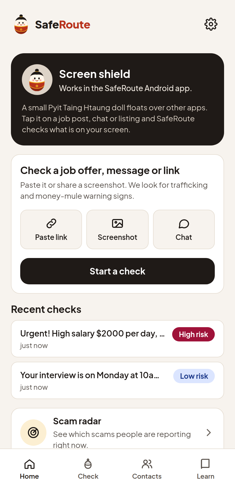
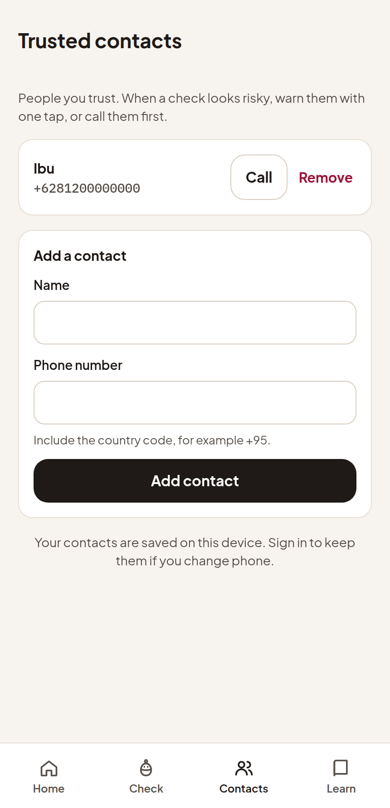
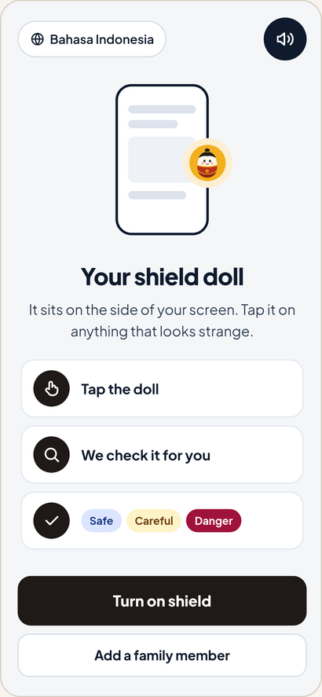
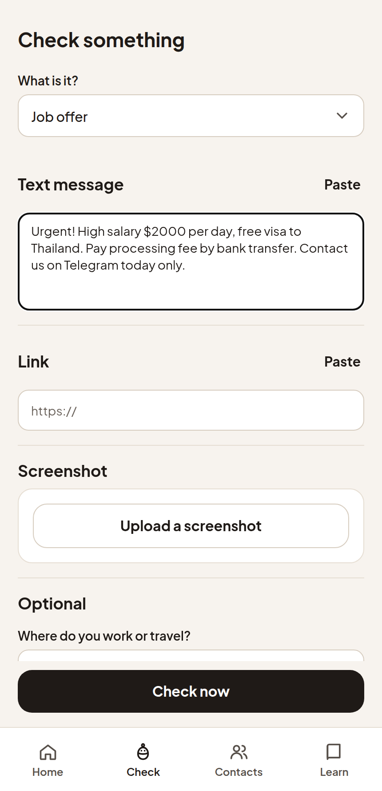
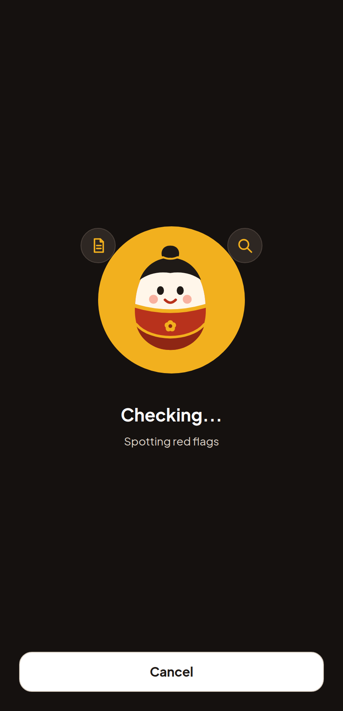
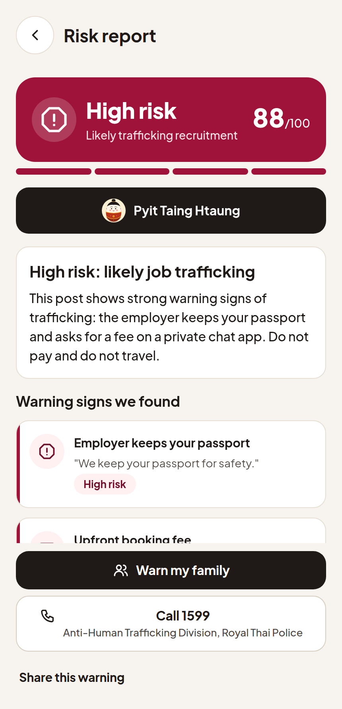
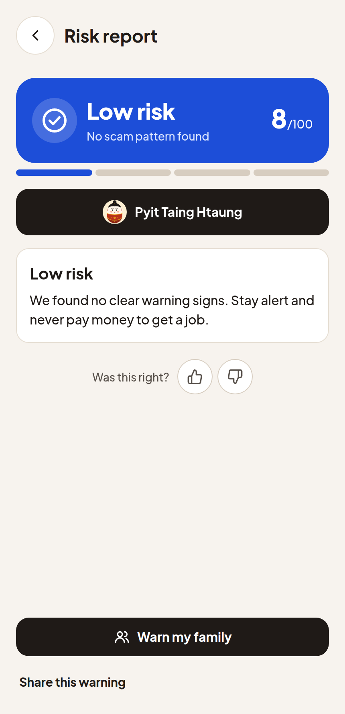

<!-- _class: dark -->
<!-- _paginate: false -->

<h1></h1>

## A shield for migrant job seekers, built on Gemini and Cloud Run

Check any job offer, chat, link or screenshot in seconds. Get a colour verdict and a spoken warning in English, Bahasa, Tagalog or Burmese.

Our mascot is the Pyit Taing Htaung, the Myanmar roly-poly doll that always gets back up.

 

Google Cloud AI Builder Cup 2026 &nbsp;|&nbsp; Track: Sustainability & Social Impact

<!--
Speaker notes: Open with one sentence. SafeRoute checks the offer before the person says yes.
-->

---

<!-- Edit this slide only if the track changes. -->

# Challenge theme and how we answer it

## Track: Sustainability & Social Impact

Theme: **supporting communities**.

SafeRoute protects people who are recruited into forced labour and online fraud, and the families who wait for them at home. It works on the phone they already own, in the language they already speak.

| Judging criterion | Where in this deck |
| --- | --- |
| Technical merit and Gen AI, 40% | Slides 7, 8, 10 |
| Problem alignment and impact, 25% | Slides 3, 4, 10 |
| Innovation and creativity, 25% | Slides 6, 8 |
| UX and solution design, 10% | Slides 5, 6, 9 |

Vision: no one leaves home for a job that is a trap. Every offer gets checked, in the person's own language, before they say yes.

---

# The problem: recruitment ads that lead to scam compounds

<b>220,000+</b>people may be held in forced online scam work: at least 120,000 in Myanmar and 100,000 in Cambodia (OHCHR, 2023)

<b>$88-114 bn</b>estimated scam losses across East and Southeast Asia, Australia and New Zealand in 2025 (UNODC, 2026)

<b>$442 bn</b>lost to scams by consumers in 42 countries in one year; 57% of adults were scammed (GASA, 2025)

 

- Many victims answer a real-looking job ad: data entry, customer service, "no experience needed".
- They travel, then lose their passport and are made to run fraud on others.
- UNODC has identified people from at least 80 countries and territories in scam compounds in the region.
- 64% of scams end within a day of first contact (GASA). The check has to happen before that.

<!-- _footer: "Sources: OHCHR via UN News, 29 Aug 2023, news.un.org/en/story/2023/08/1140187 | UNODC report of 21 Jul 2026 via OCCRP, occrp.org/en/news/un-report-details-southeast-asias-interconnected-criminal-economy | GASA and Feedzai, Global State of Scams 2025, feedzai.com/blog/gasa-global-state-of-scams-report" -->

<!--
Speaker notes. The 220,000 figure is the sum of two OHCHR numbers: "at least 120,000 people across Myanmar" and "another 100,000 in Cambodia", described as people who may be held in forced scam work.
UNODC range is $88.3 bn to $114.1 bn for 2025 (OCCRP summary of the UNODC report released 21 July 2026), covering East and Southeast Asia, Australia and New Zealand. It is a loss estimate for scams in general, not only compound scams.
GASA: 46,000 adults surveyed, 42 countries, about $442 bn lost, 57% scammed in the past year, 64% of scams over within a day of first contact. Published 9 Oct 2025.
-->

Problem alignment and impact 25%

---

# Who it is for: Rina, and the family who waits

### Rina, 24, job seeker
- Sees "Data entry staff, Thailand. High salary, free flight, no experience needed" on TikTok.
- Reads in Bahasa or Burmese, on a mid-range Android phone.
- Cannot judge a recruiter, a visa claim or a company registry by herself.

### Ibu, her mother
- Gets the warning Rina sends from her trusted contacts, with the check result in plain words.
- Calls Rina, an embassy or an NGO partner in one tap.

<figure><figcaption>Home</figcaption></figure>
<figure><figcaption>Trusted contacts</figcaption></figure>

<!-- _footer: "Rina and Ibu are design personas, not real users. Screens are captures of the running web app; the contact shown is a made-up example." -->

---

# The solution: three shields, one button

### Job Shield
Overseas offers, agency pages, recruiter claims. Checks trafficking signs, the employer and the pay.

 

### Message Shield
Chats, SMS, links. Catches romance and pig-butchering grooming, parcel phishing and known-bad links.

 

### Shop Shield
Marketplace listings and sellers. Flags prices that are too low and payment routes that cannot be recovered.

<figure><figcaption>Floating doll</figcaption></figure>

**Ways in:** paste text, share a link, upload a screenshot, or tap the floating Pyit Taing Htaung doll over any app.

**Ways out:** a verdict in three colours (safe, careful, danger), the evidence, and a spoken warning.

SafeCarefulDanger

**Built for low literacy:** large buttons, one verdict word, audio for every warning, four languages.

UX and solution design 10%

---

<!-- _class: dark -->

# Live demo: a job ad in, a verdict out

<figure><figcaption>1. Paste, upload or share</figcaption></figure>
<figure><figcaption>2. Six stages run</figcaption></figure>
<figure><figcaption>3. Danger, with voice</figcaption></figure>
<figure><figcaption>4. Safe: no false alarm</figcaption></figure>

<!--
Speaker notes. Show the web demo or the Android app. Run these flows: a pasted Burmese job post, a pig-butchering chat screenshot, a legitimate school message, and the floating doll over a social feed. Inputs are in pitch/demo-inputs.md.
-->

---

# Architecture: six stages on Google Cloud

| Stage | What it does | Google service |
| --- | --- | --- |
| 1. Capture | App or web demo sends text, link or screenshot with language | Cloud Run, `POST /v1/check`; web on Firebase Hosting |
| 2. Extract | One multimodal call reads text and image, returns flags in 7 families as JSON | Gemini API, JSON response schema |
| 3. Detect | Verifies named recruiters, companies, phones and pay against the open web | Gemini with Grounding with Google Search |
| 4. Correlate | Checks every URL for known threats and domain age (parallel with 3) | Web Risk API, RDAP |
| 5. Score | Deterministic weighted rules set the score and verdict | Cloud Run, no model call |
| 6. Explain | Plain-language verdict and spoken warning in the user's language | Gemini text-to-speech, `POST /v1/speak` |

One Cloud Run service. The Gemini API key lives in Secret Manager; Web Risk uses the service account. A 15 second budget per check: a late stage returns "unknown" and the verdict still ships.

Technical merit and Gen AI 40%

---

# Why Gen AI is essential, and what is new

### Multimodal screenshots
Scam ads and chats arrive as images, with Burmese or Thai text and mixed layouts. One Gemini call reads the image and returns structured flags. Rule-based OCR cannot judge intent.

### Grounding on the open web
A fake agency has no fixed blocklist entry. Gemini searches Google to check that the recruiter or company exists and is licensed, and shows the source pages it found.

 

### Deterministic score guard
Gemini finds and explains evidence. A tested rules engine decides the verdict. The model cannot raise a result that has no evidence.

### Native-language voice
The warning is spoken by Gemini text-to-speech, so Burmese works on phones with no Burmese voice installed.

Innovation 25%Technical merit 40%

---

# Responsible AI and privacy

### The model does not decide alone
- Each flag family counts once, at its highest severity.
- A Web Risk hit forces danger. A high trafficking flag forces danger.
- Grounded findings are capped at medium, so one search result never decides a verdict.
- Same input and same link results give the same score. The rules have unit tests.
- No flags means no danger, whatever the model says.

### Your data stays yours
- Screenshots and text are processed in memory. The service stores no request data.
- Request text and images are never written to logs.
- No API keys on the device or in the image: the service account signs calls.
- Every verdict shows its evidence and its sources, so the user can disagree.
- Hotline numbers are configured per destination and confirmed before launch.

Technical merit 40%UX 10%

---

# Feasibility, scalability and cost

- **Built and measured:** Cloud Run API, pipeline, rules engine, 49 server tests, Android app. A 19-case eval (12 scams, 7 legitimate; English, Burmese, Bahasa, Tagalog) scored 19 of 19, p50 4.4 s and p95 7.5 s per check.
- **Scales with traffic:** stateless Cloud Run autoscaling. No database to size.
- **Fails soft:** each stage has a timeout, and the verdict is built from the evidence that arrived.
- **Abuse control:** per-IP rate limits, size limits, CORS at the service edge.
- **Model choice:** gemini-3.5-flash-lite was about 2x faster than gemini-3.8-flash on the same eval.

| Estimated cost per check | USD |
| --- | --- |
| Extract (Gemini 3.5 Flash-Lite) | 0.003 |
| Spoken warning (TTS) | 0.003 |
| Grounding, when an entity is named | 0.035 |
| **Without grounding** | **about 0.006** |
| **With grounding** | **about 0.04** |

Estimate, not a measurement. Assumes 3,000 input and 800 output tokens, 250 audio tokens, list prices ($0.30 in, $2.50 out per 1M tokens), and grounding at $35 per 1,000 grounded prompts (assumed to apply to this model). Cloud Run compute is not included.

<!-- _footer: "Pricing: ai.google.dev/gemini-api/docs/pricing. Eval: server/eval, results in server/README.md." -->

<!--
Speaker notes. Arithmetic: extract 3,000 x 0.30/1M = 0.0009 plus 800 x 2.50/1M = 0.0020, about 0.003. TTS 250 audio tokens x 10/1M = 0.0025 (assumes about 10 s of audio at 25 tokens per second, priced at the upper TTS rate listed, $10 per 1M; the page lists a 3.8 Flash-Lite TTS at $6 per 1M, and the deployed id is gemini-3.8-flash-tts, so the exact rate is unconfirmed). Grounding 35/1000 = 0.035 per grounded prompt. Total about 0.006 without and 0.04 with grounding. Grounding runs only when the input names a company, agency, phone or domain. At 100,000 checks a month with 30% grounded the estimate is about 1,650 USD, compared with a Web Risk and Cloud Run bill we have not costed.
-->

Technical merit 40%Impact 25%

---

# Roadmap

| When | Milestone |
| --- | --- |
| Now | Android app and Cloud Run API. Web demo on Firebase Hosting for judges. 4 languages. Web Risk runs on the service account; live verification is pending. |
| Next 3 months | Pilot with migrant-worker NGOs and one source-country agency. Measure verdict accuracy on labelled real reports. |
| 6 months | Real Family Guardian: check-in reminders, consented sharing, embassy and NGO case handoff. |
| 12 months | More languages (Khmer, Lao, Thai, Vietnamese). Shared threat feed across partners. Grounded checks against national agency licence registries. |

 

Family Guardian is design-stage today: the screens exist, the backend does not.

Impact 25%

---

<!-- _class: dark -->

# Team

<h3>[NAME]</h3>
[Role]

<h3>[NAME]</h3>
[Role]

<h3>[NAME]</h3>
[Role]

 

Web demo: [DEPLOYED URL] &nbsp;|&nbsp; Contact: [EMAIL]

**Check before you say yes.**
