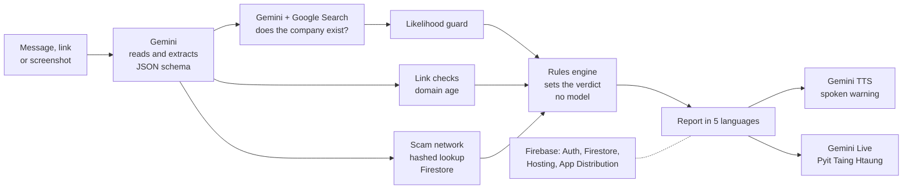

# Kakwe demo video script

TLDR: one fictional worker, Ma Su, takes one job offer from Viber to a safe decision. The film shows Check, Job Shield, the screen bubble, the Burmese voice companion and Warn my family on build 1.0.195, then 20 seconds of how it works, 14 seconds of trust and safety, 14 seconds of proof and a close. Runtime is 2:56. This script replaces the earlier "Rina" script.

**Logline.** Ma Su gets a job offer on Viber, and before she pays, sends her passport or gets in the car, Kakwe shows her the warning signs in Burmese, quoting her own messages.

**Story arc.**

1. Setup: a young woman in a Myanmar village needs work. A Viber message offers a factory job in Thailand.
2. Stakes: offers like this can end in forced scam work.
3. Turn: she checks the message. Kakwe quotes her own message back as warning signs.
4. Escalation: a cleaner-looking ad, then a recruiter who asks for a deposit and a passport photo. Job Shield puts the two side by side.
5. Pressure: the recruiter pushes in Viber. She taps the doll over the chat.
6. Decision: she asks Pyit Taing Htaung out loud, in Burmese, then warns her mother.
7. Resolution: she does not pay and does not travel. Then we show how it works and why it can be trusted.

## Contest rules this script follows

Source: aibuildercup.com, pages `themes.html` and `Faqs.html`, read on 16 October 2026.

| Rule | Quote | How the script meets it |
| --- | --- | --- |
| Video length | "a video demo under 3 minutes" (FAQ); "a public YouTube or Vimeo video or public Google drive link (3 minutes) showcasing your AI creation in action" (themes) | Runtime 2:56. Upload as public YouTube or Vimeo. |
| Language | "All submission materials, including code, documentation, and presentations, must be in English." | English voice-over. Every Burmese line has an English subtitle. |
| Platform | "all submissions must leverage Google AI models (like Gemini or Gemma) ... and they must be deployed on Google Cloud via Cloud Run or Firebase." | 1:58-2:19 names Gemini, Google Search grounding, Gemini TTS, Gemini Live and Firebase. The web demo is on Firebase Hosting. |
| Track | Sustainability & Social Impact: "Build an AI-powered solution that addresses a meaningful environmental or societal challenge. Solutions may focus on improving resource efficiency, increasing accessibility, strengthening resilience, supporting communities, or enabling more informed and sustainable decision-making." | The whole story is "supporting communities" and "more informed ... decision-making" for migrant workers. Burmese voice and plain words cover "increasing accessibility". |

### Judging criteria and where the video answers them

The same four criteria apply to every theme (FAQ).

| Criterion (quoted) | Weight | Where |
| --- | --- | --- |
| Technical Merit & Gen AI Implementation: "Meaningful use of Gen AI", "Technical implementation", "Scalability & sustainability" | 40% | 0:29-1:49 (live product, real model output), 1:58-2:19 (pipeline), 2:33-2:47 (benchmarks) |
| Problem Alignment & Impact: "Problem alignment", "Potential impact" | 25% | 0:00-0:29 (Ma Su, sourced statistic), 1:49-1:58 (family), 2:47-2:56 (close) |
| Innovation & Creativity: "Originality & differentiation", "Innovation in the use of Gen AI" | 25% | 0:49-1:14 (ad vs chat with user-editable facts), 1:14-1:49 (bubble over any app, grounded Burmese voice) |
| User Experience & Solution Design: "Usability & accessibility", "Experience & integration" | 10% | Burmese UI throughout, the 3-step meter, Leave quickly, one-tap bubble |

## Shot list (2:56)

Voice-over pace: about 135 words per minute. Total voice-over: 339 words, plus about 14 seconds of Burmese dialogue in the voice segment.

App text in **bold Burmese** is copied from the app's locale files (`src/i18n/locales/my/`) or the server's fixed copy (`server/src/explain.ts`). Lines marked **NEW** are new Burmese and need native review before recording.

| Time | Shot | Voice-over (English) | On-screen text and subtitles |
| --- | --- | --- | --- |
| 0:00-0:08 | Close-up of a phone in a young woman's hands on a wooden porch, morning light, chickens and a radio in the background. No face. Viber notification sound. | This is Ma Su. She is twenty-three, from a village in Myanmar. She needs work. | Lower third: "Ma Su, 23. Magway Region, Myanmar." Small corner tag: "A fictional story." |
| 0:08-0:18 | Screen recording on the demo phone: Viber chat with "Agent K". Message A (below) arrives. Slow push-in on "Send a photo of your passport today" and "Do not tell other people about this job". | A Viber message arrives. A factory job in Thailand. Good pay, free room. Send your passport photo today. Tell no one. | The message is legible on screen. No extra caption. |
| 0:18-0:29 | Dark lacquer-black title card. One number counts up in white, then the source line fades in. | Offers like this can end in forced scam work. The UN says at least 120,000 people in Myanmar may be held in it. | "At least 120,000 people in Myanmar may be held in forced online scam work." Source line: "OHCHR, via UN News, 29 August 2023" |
| 0:29-0:49 | Kakwe app, Burmese UI, build 1.0.195. Home, then the Check tab. "What is it?" set to **မက်ဆေ့ဂျ်** (Message). Tap Paste, tap **အခု စစ်ဆေးပါ** (Check now). The doll loader rocks, then lands. Report: red banner **အန္တရာယ်မြင့်** with the worried doll face, the 3-step meter on the third step. Hold 2 s. Scroll slowly: the first line under the banner (the next step, in the largest body type), then **တွေ့ရှိရသည့် သတိပြုဖွယ် အချက်များ** (Warning signs we found) with her message quoted in English. Rest on the call button "1599". | She pastes the message into Kakwe. Seconds later: High risk. The doll looks worried, and the meter sits on the third step. The first line says what to do. Below, her own words are quoted as warning signs. And a verified hotline, one tap away. | Subtitles: "အန္တရာယ်မြင့် = High risk". Under the first line: English subtitle of the line in this take (see "Model text" below). Highlight boxes on the quoted evidence: "Send a photo of your passport today", "Do not tell other people about this job", "A car leaves Myawaddy". Under the call button: "Anti-Human Trafficking Division, Royal Thai Police". |
| 0:49-1:14 | Check tab, "What is it?" set to **အလုပ်ကမ်းလှမ်းချက်** (Job offer). Paste Ad B into **အလုပ်ကြော်ငြာ** (The job ad) and Chat B into **အလုပ်ရှာပေးသူက သင့်ကို မေးမြန်းထားသည်များ** (What the recruiter asked you). Tap **ဤစာသားများကို စစ်ဆေးပါ** (Read these texts). Fact screen **ဤအချက် မှန်ပါသလား။** (Is this right?): scroll the facts, each with **မူရင်းစာသား** (Text it came from). Tap **ပြင်ဆင်ရန်** (Edit) on Salary, show the field, tap Done without a change. Tap **မှန်ကန်ပါသည်၊ စစ်ဆေးပါ** (Looks right, check it). Result: meter on **ခဏရပ်ပါ** (Pause). Scroll to **မကိုက်ညီသည့် အချက်များ** (What doesn't match): the fee card with both quotes, then the documents card. | Then she finds a cleaner ad. Job Shield reads the ad and the recruiter's chat together. First it asks: is this right? Each fact shows the words it came from. She can fix any of them. The result: Pause. The ad says no fees. The chat wants a 300 dollar deposit today, and a passport photo. | Subtitles for each Burmese heading as listed in the shot column. On the fee card, enlarge the two quotes side by side: "The ad says: No agency fees." / "The chat says: pay a 300 USD deposit today". Meter subtitle: "Fewer signs / Check first / Pause". |
| 1:14-1:28 | Android screen recording. Viber chat with Agent K; message C arrives. The Kakwe doll bubble floats at the right edge. Tap the doll. It rocks while it checks. The pill opens: **အန္တရာယ်မြင့်** badge, the title, and the **မေးမယ်** (Ask) chip. Tap the arrow: flags, the thumbnail and **ဒါကတော့ စစ်ဆေးပေးထားတဲ့ အရာပါ** (This is what we checked). Tap **အစီရင်ခံစာ အပြည့်အစုံ** (Full report). | Back in Viber, the recruiter pushes: pay today. She does not copy anything. She taps the doll floating over the chat. It checks the screen and shows what it checked. | Subtitles: "High risk", "Many warning signs: please pause and check first" (title, fixed server copy **သတိပေးလက္ခဏာ များစွာ တွေ့ရသည်: ခဏရပ်ပြီး စစ်ဆေးပါ**), "This is what we checked". Small tag: "Android". |
| 1:28-1:49 | Full report. Tap **ပစ်တိုင်းထောင်နဲ့ စကားပြောမယ်** (Talk to Pyit Taing Htaung). Voice sheet. Cut the spoken warning short in the edit. Ma Su speaks off camera. The doll answers in a woman's voice. Ma Su asks to warn her mother; the warn sheet opens. | She can also ask out loud, in Burmese. Pyit Taing Htaung answers only from this report. (Then the voice-over stops and the dialogue plays.) | Ma Su (NEW): **စရံငွေ ၃၀၀ ဒေါ်လာ အရင်ပေးရမယ်တဲ့။ ပေးလိုက်ရမလား။** Subtitle: "They say I must pay a 300 dollar deposit first. Should I pay?" Pyit Taing Htaung: English subtitle of the answer in this take. Ma Su (NEW): **အမေ့ကို သတိပေးချင်တယ်။** Subtitle: "I want to warn my mother." Corner tag: "Gemini Live". |
| 1:49-1:58 | Warn sheet: **ဤသတိပေးချက်ကို မျှဝေရန်** (Share this warning). Android share sheet, pick Viber, pick the chat "အမေ" (Mum). The Burmese warning text is pre-filled. Tap send. | Warn my family shares the warning through any chat app. No account needed. | Subtitle: "Share this warning". Caption: "No account needed. Saving contacts needs sign-in." |
| 1:58-2:19 | Animated diagram (see "Diagram"). Each box lights up as the voice-over names it. End on the full diagram for 2 s. | Gemini reads a message or screenshot and returns evidence as JSON. Gemini with Google Search checks that named companies exist. A guard keeps every sentence in likelihood words. Fixed rules, not the model, set the verdict. Gemini TTS and Live give it a voice. Firebase hosts the web demo. | Box labels as in the diagram. Footer: "gemini-3.5-flash-lite · gemini-3.8-flash-tts · gemini-3.8-live" |
| 2:19-2:33 | Three quick cuts, 4 s each: (1) a report line with "shows signs of" highlighted; (2) tap **အမြန်ထွက်မည်** (Leave quickly), the app jumps to Home; (3) onboarding sharing screen with **ကျေးဇူးပါ၊ မလိုပါ** (No thanks) next to Yes. | Kakwe speaks in likelihood. It never calls a person a criminal. Leave quickly clears the screen in one tap. Sharing scam patterns is opt-in, and numbers are kept only as one-way hashes. | (1) "Likelihood, never accusation" (2) "Leave quickly" (3) "Opt-in. Hashed phone numbers and handles. Deleted after 90 days." Bottom line through all three: "History keeps only the verdict and the summary, and can be turned off. For ages 18 and older." |
| 2:33-2:47 | Three stat cards on the light page colour, one after another, then the Hugging Face dataset page scrolling past its "Configs" table. | We measure it. Every text case passed. A Protection Score of 89.7 on synthetic screenshots. Real screenshots are harder. We published 93 of them. | Card 1: "Text eval: 31/31 correct. 0 certainty phrases after the guard." Card 2: "Protection Score 89.7 / 100. 24 synthetic screenshots, 5 languages. 0 critical failures." Card 3: "Real redacted screenshots: about 67. Provisional, draft labels." Dataset: "huggingface.co/datasets/Rickaym/saferoute-scam-screenshots" |
| 2:47-2:56 | Back to the porch. The phone is face down. Cut to the logo lockup on lacquer black with links. | Ma Su did not pay. She did not travel. Kakwe: check before you say yes. | **သဘောမတူခင် အရင်စစ်ဆေးပါ** = "Check before you say yes". Links: "saferoute-aibc.web.app", "saferoute-aibc.web.app/saferoute.apk", "github.com/minthein128/scamshield". "Team: Ricky, Min Thein Kyaw". "Built with Gemini and Firebase." |

### Model text

The report title on a High risk result is fixed server copy. The summary, the first line under the banner, the flag labels and the voice answers are written by Gemini and change from take to take. Subtitle what the take shows. In the test runs on 16 October the gist was:

| Where | Burmese in the test run | English gist |
| --- | --- | --- |
| Check, first line under the banner | ငွေမလွှဲပါနဲ့၊ ပတ်စပို့ကို သူများလက်ထဲ မပေးပါနဲ့ဦး။ | "Do not send money. Do not hand your passport to anyone yet." |
| Job Shield headline (fixed app copy) | ငွေမလွှဲခင်၊ စာရွက်စာတမ်း မပို့ခင် သို့မဟုတ် ခရီးမထွက်ခင် ခဏရပ်ပါ | "Pause before you pay, send documents or travel" |
| Pyit Taing Htaung, expected answer | Recorded live | "This shows warning signs of a fee scam. Please do not pay yet. Talk to someone you trust, or call the hotline." |

A Burmese reader on the team checks every subtitle against the recorded take before export.

## Diagram



Draw it in the brand palette: boxes on the warm page colour `#F7F3EE`, lacquer-black text and arrows, Google service names in bold. Keep red and gold for the doll only.

## Recording checklist

### Build and backend

- Android build **1.0.195** (Android workflow run 38919909379 on `feat/production` at `02fe69b2`), from Firebase App Distribution. Check the version in Android App info before the first take.
- The API answers at `https://sg-dev-808112092414.asia-southeast1.run.app/health` with `"mock": false`. Check it before each session. The app must not show the "Offline demo mode" banner.
- Run every input once before the take. An identical check within an hour comes from the server cache, so the recorded take is fast and gives the same result.
- If a take fails, open Settings, Diagnostics log, and read the last error.

### Device setup

- One physical Android phone, Android 11 or later, 1080 x 2400 or similar. The bubble needs Android; the web demo does not have it.
- Clean demo profile: uninstall and reinstall, or clear app data. In onboarding pick **Myanmar** (one setting for the UI, reports, spoken warnings and the voice), from Myanmar, to Thailand. Stay anonymous (no sign-in). On the sharing step tap **No thanks**, so demo checks add nothing to the scam network.
- On Home, turn on the Screen shield. Allow notifications and "Display over other apps". The first tap on the doll asks to share the screen; tap Start now. Allow the microphone for the voice companion.
- Do Not Disturb on, all other notifications off, battery full, wallpaper plain. Settings, Developer options, Show taps on.
- Viber with three test accounts: the demo phone ("Ma Su"), a second phone saved as "Agent K", and a third saved as "အမေ" (Mum). Use no real names, photos or numbers. Turn off Viber profile photos.

### How to record

- App screens: `scrcpy --record take.mp4` from a laptop gives a clean 1080p file. The built-in Android screen recorder also works.
- Bubble: record on the phone itself or with scrcpy. The bubble draws over Viber, so the capture must be the whole screen, not one app.
- Voice: Android 11 or later records app audio with "Media and microphone" in the built-in recorder, or `scrcpy --audio-source=output` for app audio. Test once that Pyit Taing Htaung's voice is in the file. If it is not, record the room with a USB microphone next to the phone and sync the two tracks in the edit. Ma Su's lines are spoken by a Burmese-speaking team member or a volunteer, off camera.
- The voice sheet first plays the spoken warning. Keep it in the raw take and cut it in the edit.
- Record the English voice-over separately in a quiet room. Leave half a second of silence at every cut.
- Opening and closing B-roll: hands and a phone only, no faces, no real location names on screen. Licensed stock footage of a village is fine if it shows no identifiable person.
- Take order: Check, Job Shield, bubble, voice, Warn my family, Leave quickly, onboarding sharing screen. Then the diagram and the stat cards.

### Final checks before export

- Runtime under 3:00 (target 2:56).
- Every Burmese line has an English subtitle. Subtitles stay at least 2 seconds and under 12 words.
- No real person, company or private phone number on screen. The hotline numbers shown are official public lines from `src/data/hotlines.ts`.
- Nothing on screen or in the voice-over says a message "is" a scam or names a person as a criminal.
- The voice-over and the diagram name only the Google services in the diagram.

## Demo inputs

All names, companies, handles and numbers are fictional, including "Kinnari Thread Works". Mae Sot and Myawaddy are real towns and appear only as places.

**A. Viber message from Agent K (Check, Message).** Tested live on 16 October 2026: High risk, score 100, likely trafficking recruitment, hotline 1599.

```
Hello sister! Factory job in Mae Sot, Thailand. Salary 18,000 baht per month, free food and room. No experience needed. We take care of the passport and visa. Send a photo of your passport today to book your seat. A car leaves Myawaddy on Friday night. Only 3 places left. Do not tell other people about this job.
```

**B. Job Shield (Job offer).** Tested live on 16 October 2026: Pause, with three mismatches (fee, documents, contract).

The job ad:

```
Kinnari Thread Works Co., Ltd. is hiring sewing machine operators in Mae Sot, Thailand. Salary 12,000 THB per month. No agency fees. Official contract and work permit provided. Apply at our office.
```

What the recruiter asked you:

```
Hi sister, to keep your place please pay a 300 USD deposit today to this account. Also send a clear photo of your passport. We sign the contract after you arrive.
```

**C. Viber message for the bubble.** Tested live as text on 16 October 2026: High risk, score 100. Send it from the Agent K phone so it shows in the chat.

```
Sister, the deposit is 300 USD. Pay today or your seat goes to someone else. Send your passport photo too. Please keep this between us.
```

**D. Ma Su's spoken lines (NEW Burmese, needs native review).**

| Burmese | English subtitle |
| --- | --- |
| စရံငွေ ၃၀၀ ဒေါ်လာ အရင်ပေးရမယ်တဲ့။ ပေးလိုက်ရမလား။ | They say I must pay a 300 dollar deposit first. Should I pay? |
| အမေ့ကို သတိပေးချင်တယ်။ | I want to warn my mother. |

The second line asks for the warn sheet. The voice companion opens it only when the listener asks in words, so say it plainly.

### Burmese app strings used on screen

All are shipped app copy. The Burmese locale files are machine translated and still marked `"reviewed": false`, so a native reader checks these too.

| Key | Burmese | English |
| --- | --- | --- |
| `common.verdict.danger` | အန္တရာယ်မြင့် | High risk |
| `check.kinds.message` | မက်ဆေ့ဂျ် | Message |
| `check.kinds.job` | အလုပ်ကမ်းလှမ်းချက် | Job offer |
| `check.submit` | အခု စစ်ဆေးပါ | Check now |
| `report.flagsRisky` | တွေ့ရှိရသည့် သတိပြုဖွယ် အချက်များ | Warning signs we found |
| `check.job.facts.title` | ဤအချက် မှန်ပါသလား။ | Is this right? |
| `check.job.facts.quoteLabel` | မူရင်းစာသား | Text it came from |
| `check.job.facts.submit` | မှန်ကန်ပါသည်၊ စစ်ဆေးပါ | Looks right, check it |
| `report.attention.word.pause` | ခဏရပ်ပါ | Pause |
| `report.attention.word.verify` | အရင်စစ်ဆေးပါ | Check first |
| `report.attention.word.lower` | သတိပေးချက် နည်းသည် | Fewer signs |
| `report.conflicts.title` | မကိုက်ညီသည့် အချက်များ | What doesn't match |
| `report.conflicts.adSays` | ကြော်ငြာတွင် ဖော်ပြထားသည်မှာ | The ad says |
| `report.conflicts.chatSays` | စကားပြောရာတွင် ပြောထားသည်မှာ | The chat says |
| `live.companion.ask` | မေးမယ် | Ask |
| `live.companion.whatWeChecked` | ဒါကတော့ စစ်ဆေးပေးထားတဲ့ အရာပါ | This is what we checked |
| `live.button` | ပစ်တိုင်းထောင်နဲ့ စကားပြောမယ် | Talk to Pyit Taing Htaung |
| `report.warn` | မိသားစုကို သတိပေးပါ | Warn my family |
| `contacts.warn.shareNow` | ဤသတိပေးချက်ကို မျှဝေရန် | Share this warning |
| `common.actions.leave` | အမြန်ထွက်မည် | Leave quickly |
| `onboarding.how.check.title` | သဘောမတူခင် အရင်စစ်ဆေးပါ | Check before you say yes |
| `onboarding.language.age` | ကာကွယ် သည် အသက် ၁၈ နှစ်နှင့်အထက် ရှိသူများအတွက် ဖြစ်ပါသည်။ | Kakwe is for people aged 18 and older. |

## Appendix: 60-second cut-down

For social posts and a short preview. Same footage, 96 words of voice-over.

| Time | Shot | Voice-over | On-screen text |
| --- | --- | --- | --- |
| 0:00-0:08 | Porch, phone, Viber message A arrives. | Ma Su needs work. A Viber message offers a job in Thailand. Send your passport photo today. | "Ma Su, 23, Myanmar. A fictional story." |
| 0:08-0:20 | Check: paste, High risk banner, worried doll, meter, quoted evidence. | She checks it in Kakwe, in Burmese. High risk. Her own words are quoted as warning signs, with a verified hotline. | "အန္တရာယ်မြင့် = High risk" |
| 0:20-0:34 | Job Shield: "Is this right?", then Pause and the fee card. | Job Shield reads the ad and the recruiter's chat. The ad says no fees. The chat wants a 300 dollar deposit. | "The ad says: No agency fees." / "The chat says: pay a 300 USD deposit today" |
| 0:34-0:45 | Bubble over Viber, tap, pill opens. Then one Burmese question and the start of the answer. | A doll floats over any app. One tap checks the screen. She can ask out loud, in Burmese. | Ma Su's question with its English subtitle. |
| 0:45-0:53 | Diagram, full view. | Gemini finds the evidence. Google Search checks the company. Fixed rules set the verdict. | "Gemini · Google Search grounding · Gemini Live · Firebase" |
| 0:53-1:00 | Logo and links. | Kakwe. Check before you say yes. | "saferoute-aibc.web.app" · "saferoute-aibc.web.app/saferoute.apk" · "github.com/minthein128/scamshield" |
