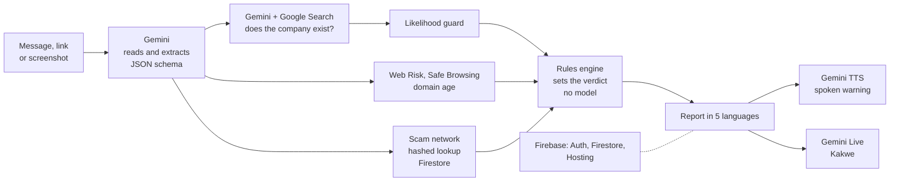

# Kakwe demo video script

TLDR: a presenter-led walkthrough for the Google Cloud AI Builder Cup 2026 judges. Estimated runtime 2:48 at about 140 words a minute. The live product, the pipeline and the results take 1:56 (69%), because Technical Merit (40%), Innovation (25%) and User Experience (10%) are all judged on what the judges see working. The purpose, the problem, the user and the close take 0:43 (26%) for Problem Alignment and Impact (25%). Responsible AI takes 0:09 and also shows on screen during the demo. The film uses build 1.0.269 and fictional inputs only.

This script replaces the earlier story version with the persona Ma Su.

## Time budget against the judging criteria

| Criterion | Weight | Segments | Time |
| --- | --- | --- | --- |
| Technical Merit and Gen AI Implementation | 40% | 4 to 8 (live product), 9 (how it works), 10 (results) | 1:56 shared |
| Innovation and Creativity | 25% | 5 (Job Shield), 6 (bubble), 7 (voice), 9 (evidence, not verdict) | inside the 1:56 |
| Problem Alignment and Impact | 25% | 1 to 3 (purpose, problem, user), 12 (close) | 0:43 |
| User Experience and Solution Design | 10% | Burmese UI throughout 4 to 8, Quick exit in 11 | inside the 1:56 |

Segment 11 covers Responsible AI (0:09).

## Script

Presenter voice: calm, even pace, no music bed louder than a low pad. App text in Burmese is copied from the app's locale files. Every Burmese line has an English subtitle.

| # | Time | ON SCREEN | NARRATION |
| --- | --- | --- | --- |
| 1 | 0:00-0:09 | Title card on lacquer black. Doll logo, "Kakwe (ကာကွယ်)", line "Check a job offer before you say yes". Footer: "Google Cloud AI Builder Cup 2026. Team Super Power Rangers." | This is Kakwe, which means protect in Burmese. It checks a job offer before a person pays, sends documents or travels. |
| 2 | 0:09-0:24 | Full-screen statistic on lacquer black. "120,000" appears, then the line "At least 120,000 people in Myanmar may be held in forced online scam work." Source line fades in: "OHCHR, via UN News, 29 August 2023". | Recruitment ads on Facebook, Viber and Telegram draw job seekers into forced online scam work. The UN human rights office reported in 2023 that at least 120,000 people in Myanmar may be held in it. |
| 3 | 0:24-0:30 | Slide "Who it is for". Four labels: Myanmar, Thailand, Indonesia, Philippines. Line: "Migrant job seekers, 18 and older." | Kakwe is for migrant job seekers from Myanmar, Thailand, Indonesia and the Philippines. |
| 4 | 0:30-0:47 | Demo phone, app in Burmese. Home, then the Check tab. "What is it?" set to Message (**မက်ဆေ့ဂျ်**). Tap Paste (input A below), tap **အခု စစ်ဆေးပါ** (Check now). The doll loader runs, then the report opens: red banner **အန္တရာယ်မြင့်** (High risk), the 3-step meter on step three. Scroll to **တွေ့ရှိရသည့် သတိပြုဖွယ် အချက်များ** (Warning signs we found) with the pasted lines quoted. Rest on the call button "1599". Subtitle: "High risk". Callouts on the quotes. | The user pastes a message or shares a screenshot. Kakwe returns a verdict, here High risk. The report gives the next step first, then quotes the user's own message as warning signs. A verified hotline is one tap away. |
| 5 | 0:47-1:07 | Check tab, "What is it?" set to Job offer (**အလုပ်ကမ်းလှမ်းချက်**). Paste input B ad and chat. Tap **ဤစာသားများကို စစ်ဆေးပါ**. Fact screen **ဤအချက် မှန်ပါသလား။** (Is this right?): scroll two facts with **မူရင်းစာသား** (Text it came from). Tap **မှန်ကန်ပါသည်၊ စစ်ဆေးပါ**. Result: **ခဏရပ်ပါ** (Pause). Scroll to **မကိုက်ညီသည့် အချက်များ** (What doesn't match): the fee card with both quotes side by side. Callouts: "The ad says: No agency fees." and "The chat says: pay a 300 USD deposit today". | Job Shield compares a job ad with the recruiter's chat. Gemini extracts the facts, and the user can correct any of them. The result is Pause. Under What doesn't match, the ad says no agency fees, and the chat asks for a 300 dollar deposit. |
| 6 | 1:07-1:16 | Android screen recording. Viber chat with message C. The Kakwe doll bubble floats at the right edge. Tap the doll. Android shows "Start recording or casting with Kakwe?". Tap "Start now". One frame is captured and sharing stops at once. The result pill opens over Viber: **အန္တရာယ်မြင့်** badge and the title. Tag: "Android". | On Android, a floating bubble sits over any app. Each tap asks permission, captures once, and stops sharing. |
| 7 | 1:16-1:31 | Full report. Tap **ကာကွယ်နဲ့ စကားပြောမယ်** (Talk to Kakwe). Voice sheet. Narration stops. Spoken dialogue plays: the user asks in Burmese (line D1), the companion answers. Subtitles on both lines. Tag: "Gemini Live". | The voice companion, Kakwe, takes spoken questions in Burmese. It answers only from the finished report. |
| 8 | 1:31-1:40 | Report. Tap **မိသားစုကို သတိပေးပါ** (Warn my family). Warn sheet, then **ဤသတိပေးချက်ကို မျှဝေရန်** (Share this warning), share sheet, pick a chat. Then Settings, language list shown briefly. | Warn my family shares the report through any chat app. The app speaks Burmese, English, Bahasa Indonesia, Tagalog and Thai. |
| 9 | 1:40-2:08 | Architecture diagram (see Diagram). Each box lights up as it is named. End on the full diagram for 2 seconds. Footer: "gemini-3.5-flash-lite, gemini-3.8-flash-tts, gemini-3.8-live". | Gemini reads the text or image and returns evidence as structured JSON. Google Search grounding checks that named companies exist. It supplies evidence, not a verdict. Web Risk and Safe Browsing check links. Deterministic rules set the score. A guard rewrites certainty wording into likelihood language. Gemini TTS and Live give the voice. The API runs on Cloud Run behind a Cloudflare edge, with Firebase. |
| 10 | 2:08-2:26 | Four stat cards, one after another: "31/31 text eval cases correct. 0 certainty phrases." "Protection Score 89.7. 24 synthetic screenshots." "Job Shield 10/10 pairs." "Public dataset: 93 real, 28 synthetic screenshots." Small note under the cards: "Real-screenshot score is provisional." | The text eval passes 31 of 31 cases, with no certainty phrases. The Protection Score is 89.7 on synthetic screenshots. Job Shield passes 10 of 10 pairs. The public dataset has 93 real and 28 synthetic screenshots. The real-screenshot score is provisional. |
| 11 | 2:26-2:35 | Three quick cuts, about 2.5 seconds each: a report line with "shows signs of" highlighted; the onboarding sharing step with **ကျေးဇူးပါ၊ မလိုပါ** (No thanks) beside Yes; tap Quick exit (**အမြန်ထွက်မည်**) and the app returns to Home. Captions: "Likelihood, never accusation", "Sharing is opt-in", "Quick exit". | Reports use likelihood wording and never accuse. Sharing is opt-in, numbers are stored as hashes, and Quick exit clears the screen. |
| 12 | 2:35-2:48 | Close card on lacquer black. Links: "Web demo: saferoute-aibc.web.app", "Android APK: saferoute-aibc.web.app/kakwe.apk", "GitHub: github.com/minthein128/scamshield". Team line: "Team Super Power Rangers: Pyae Sone Myo (Ricky), Min Thein Kyaw, May Myat Noe Aung." | Kakwe is open for review. The demo, APK and code are linked here. Team Super Power Rangers: Pyae Sone Myo, called Ricky, Min Thein Kyaw and May Myat Noe Aung. |

## Word count and duration

| Item | Value |
| --- | --- |
| Narration words | 365 |
| Narration at 140 words a minute | 2:36 |
| Spoken Burmese dialogue (segment 7) | about 0:07 |
| Estimated runtime | 2:48 (limit 3:00) |

Segment 7 holds the dialogue, so its narration is short. If the take runs long, cut the language list in segment 8 first, then the stat note in segment 10.

## Diagram



Draw it in the brand palette: boxes on the warm page colour `#F7F3EE`, lacquer-black text and arrows, Google service names in bold. Keep red and gold for the doll only.

## Shot list for recording

1. Voice-over first, in a quiet room, one take per segment. Leave half a second of silence at every cut.
2. Phone: one physical Android phone, Android 11 or later, build 1.0.269, clean profile, language Myanmar, anonymous, "No thanks" on the sharing step. Turn on the Screen shield and allow overlay and microphone. Turning the shield on does not ask for screen capture. Each bubble tap shows Android's "Start recording or casting with Kakwe?" dialog; tap "Start now". Do Not Disturb on, Show taps on.
3. Check the API before each session: the health endpoint answers with `"mock": false`, and the app shows no "Offline demo mode" banner.
4. Run every input once before recording. An identical check within 10 minutes comes from the cache, so the take is fast and gives the same result.
5. Screen takes, in this order: Check (input A), Job Shield (input B), bubble over Viber (input C, record the whole screen, include the permission dialog and the Start now tap), voice companion (record app audio, or room audio synced in the edit), Warn my family, language list, then the three Responsible AI cuts.
6. Graphics: title card, statistic card with source line, "Who it is for" slide, diagram animation, four stat cards, close card with links.
7. Voice lines D1 and D2 are spoken off camera by a Burmese speaker. Cut the spoken warning that plays when the voice sheet opens.
8. Subtitles: English under every Burmese line, at least 2 seconds on screen, under 12 words.
9. Model text (summary, first line, voice answers) changes between takes. Subtitle what the take shows.
10. Check before export: runtime under 3:00, no real person, company or number on screen, nothing says a message "is" a scam, the Burmese strings checked by a native reader (the Burmese locale files are machine translated and marked `"reviewed": false`).

## Demo inputs

All names, companies, handles and numbers are fictional. Mae Sot and Myawaddy are real towns and appear only as places. The inputs are the ones tested live on 16 October 2026 (see `pitch/demo-inputs.md` for the wider input set).

**A. Check, Message.** Result: High risk, hotline 1599.

```
Hello sister! Factory job in Mae Sot, Thailand. Salary 18,000 baht per month, free food and room. No experience needed. We take care of the passport and visa. Send a photo of your passport today to book your seat. A car leaves Myawaddy on Friday night. Only 3 places left. Do not tell other people about this job.
```

**B. Job Shield, Job offer.** Result: Pause, with three mismatches (fee, documents, contract).

The job ad:

```
Kinnari Thread Works Co., Ltd. is hiring sewing machine operators in Mae Sot, Thailand. Salary 12,000 THB per month. No agency fees. Official contract and work permit provided. Apply at our office.
```

What the recruiter asked you:

```
Hi sister, to keep your place please pay a 300 USD deposit today to this account. Also send a clear photo of your passport. We sign the contract after you arrive.
```

**C. Viber message for the bubble.** Result: High risk. Send it from the second phone so it shows in the chat.

```
Sister, the deposit is 300 USD. Pay today or your seat goes to someone else. Send your passport photo too. Please keep this between us.
```

**D. Spoken lines (Burmese, needs native review).**

| Line | Burmese | English subtitle |
| --- | --- | --- |
| D1 | စရံငွေ ၃၀၀ ဒေါ်လာ အရင်ပေးရမယ်တဲ့။ ပေးလိုက်ရမလား။ | They say I must pay a 300 dollar deposit first. Should I pay? |
| D2 | အမေ့ကို သတိပေးချင်တယ်။ | I want to warn my mother. |

Line D2 asks for the warn sheet. The voice companion opens it only when the listener asks in words.
